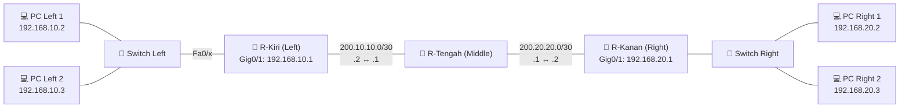

<div align="center">

# 🌐 5 Routing Protocols. 1 Topology. Zero Excuses.

### Static • EIGRP • RIPv2 • OSPF • BGP — all in **Cisco Packet Tracer**


**🇬🇧 English** &nbsp;|&nbsp; [🇮🇩 Bahasa Indonesia](README.id.md)

</div>

---

## 🎯 What Is This?

Same network. Same IP scheme. **Five different brains** deciding where packets go.

This repo packs everything into one Packet Tracer file (`ROUTING.pkt`) so you can put **Static, EIGRP, RIPv2, OSPF and BGP** side by side and actually *see* how they differ: the CLI, the routing tables, the metrics, the behavior. Great for networking classes, CCNA prep, labs, or just flexing.

> ⚡ **TL;DR:** clone it → open `ROUTING.pkt` → ping from the left LAN to the right LAN → profit.

---

## 📋 Table of Contents

1. [Repository Structure](#-repository-structure)
2. [Quick Start](#-quick-start)
3. [Topology & IP Addressing](#-topology--ip-addressing)
4. [Protocol Showdown](#-protocol-showdown)
5. [Base Configuration](#-base-configuration)
6. [The 5 Routing Configs](#-the-5-routing-configs)
7. [Verification (Ping & Traceroute)](#-verification-ping--traceroute)
8. [Handy Show Commands](#-handy-show-commands)
9. [Troubleshooting](#-troubleshooting)
10. [Author](#-author)

---

## 📁 Repository Structure

```text
📦 5-simple-routing
 ┣ 📂 configs/
 ┃ ┣ 📄 1-static-config.txt   # Full CLI script: Static Routing
 ┃ ┣ 📄 2-eigrp-config.txt    # Full CLI script: EIGRP
 ┃ ┣ 📄 3-ripv2-config.txt    # Full CLI script: RIPv2
 ┃ ┣ 📄 4-ospf-config.txt     # Full CLI script: OSPF
 ┃ ┗ 📄 5-bgp-config.txt      # Full CLI script: eBGP
 ┣ 📄 LICENSE
 ┣ 📄 README.md               # You are here (English)
 ┣ 📄 README.id.md            # Bahasa Indonesia version
 ┗ 📄 ROUTING.pkt             # The main Packet Tracer simulation
```

---

## 🚀 Quick Start

### 1️⃣ What You Need
* **Cisco Packet Tracer 8.0+** (older versions may refuse to open the `.pkt`).

### 2️⃣ Fire It Up
1. Clone the repo (or just grab `ROUTING.pkt`):
   ```bash
   git clone https://github.com/rizqi-yusuf/5-simple-routing.git
   ```
2. Open **Cisco Packet Tracer** and log in with your Cisco NetAcad / Skills for All account.
3. Go to **File → Open** and pick **`ROUTING.pkt`**.
4. Wait **30–50 seconds**, or smash **Fast Forward Time** (`Alt + D`) a few times, until the link lights go from 🟠 orange to 🟢 green (STP and routing convergence doing their thing).

### 3️⃣ Test the Network
| Method | How |
| :--- | :--- |
| 📨 **Simple PDU** | Press **`P`**, click **Left PC** (`192.168.10.2`), then **Right PC** (`192.168.20.2`). Check the bottom-right corner for **`Successful`**. |
| 💻 **Command Prompt** | Click a PC → **Desktop** → **Command Prompt** → `ping 192.168.20.2` |

---

## 🖧 Topology & IP Addressing

<div align="center">


</div>



**Hardware per topology:**
* 🧭 **3× Cisco 2911 routers** (Middle, Left, Right)
* 🔀 **2× Cisco 2960-24TT switches** (Left, Right)
* 💻 **4× PC-PT** (2 on the left LAN, 2 on the right LAN)

> 💡 **Subnetting heads-up:**
> The topology labels show `/32` on the router-to-router links (`200.10.10.0` and `200.20.20.0`). In the actual CLI we use **`/30` (`255.255.255.252`)**, because a point-to-point link between two routers needs 2 usable host IPs. The PC-facing LANs use **`/24` (`255.255.255.0`)**.

### 📒 Addressing Table (same for all 5 topologies)

| Device | Interface | IP Address | Subnet Mask | Wildcard | Default Gateway | Notes |
| :--- | :--- | :--- | :--- | :--- | :--- | :--- |
| **R-Tengah (Middle)** | `Gig0/0` | `200.10.10.1` | `255.255.255.252` | `0.0.0.3` | - | Link to R-Kiri (`Gig0/0`) |
| | `Gig0/1` | `200.20.20.1` | `255.255.255.252` | `0.0.0.3` | - | Link to R-Kanan (`Gig0/0`) |
| **R-Kiri (Left)** | `Gig0/0` | `200.10.10.2` | `255.255.255.252` | `0.0.0.3` | - | Link to R-Tengah (`Gig0/0`) |
| | `Gig0/1` | `192.168.10.1` | `255.255.255.0` | `0.0.0.255` | - | Gateway for the left LAN |
| **R-Kanan (Right)** | `Gig0/0` | `200.20.20.2` | `255.255.255.252` | `0.0.0.3` | - | Link to R-Tengah (`Gig0/1`) |
| | `Gig0/1` | `192.168.20.1` | `255.255.255.0` | `0.0.0.255` | - | Gateway for the right LAN |
| **PC Left 1** | `Fa0` | `192.168.10.2` | `255.255.255.0` | - | `192.168.10.1` | Left Switch `Fa0/1` |
| **PC Left 2** | `Fa0` | `192.168.10.3` | `255.255.255.0` | - | `192.168.10.1` | Left Switch `Fa0/2` |
| **PC Right 1** | `Fa0` | `192.168.20.2` | `255.255.255.0` | - | `192.168.20.1` | Right Switch `Fa0/1` |
| **PC Right 2** | `Fa0` | `192.168.20.3` | `255.255.255.0` | - | `192.168.20.1` | Right Switch `Fa0/2` |

---

## 🥊 Protocol Showdown

| Parameter | 🧱 Static | ⚡ EIGRP | 🐢 RIPv2 | 🗺️ OSPF | 🌍 BGP (eBGP) |
| :--- | :--- | :--- | :--- | :--- | :--- |
| **Type** | Manual | Dynamic (IGP) | Dynamic (IGP) | Dynamic (IGP) | Dynamic (EGP) |
| **Algorithm** | Hand-typed entries | Advanced Distance-Vector (DUAL) | Distance-Vector (Bellman-Ford) | Link-State (Dijkstra SPF) | Path-Vector |
| **Admin Distance** | `1` | `90` | `120` | `110` | `20` |
| **Best-Path Metric** | Whatever you say | Bandwidth & Delay | Hop count (max 15) | Cost (bandwidth-based) | Path attributes (AS-Path) |
| **Update Address** | None | Multicast `224.0.0.10` | Multicast `224.0.0.9` | Multicast `224.0.0.5` / `.6` | Unicast TCP port `179` |
| **Code in `show ip route`** | `S` | `D` | `R` | `O` | `B` |

### 🧠 Which One Should You Use?

| Situation | Go with |
| :--- | :--- |
| Tiny network, few routes, full control | 🧱 **Static** |
| Cisco-only network, fast convergence | ⚡ **EIGRP** |
| Small lab, simplicity over speed | 🐢 **RIPv2** |
| Mixed vendors, mid-to-large network | 🗺️ **OSPF** |
| Connecting separate organizations / ISPs | 🌍 **BGP** |

---

## ⚙️ Base Configuration

Before touching any routing protocol, put this base IP config on all three routers in every topology:

<details>
<summary><b>👉 Click to expand the base config for all 3 routers</b></summary>

#### 1. R-Tengah (Middle)
```cisco
enable
configure terminal
hostname R-Tengah
interface GigabitEthernet0/0
 ip address 200.10.10.1 255.255.255.252
 no shutdown
exit
interface GigabitEthernet0/1
 ip address 200.20.20.1 255.255.255.252
 no shutdown
exit
```

#### 2. R-Kiri (Left)
```cisco
enable
configure terminal
hostname R-Kiri
interface GigabitEthernet0/0
 ip address 200.10.10.2 255.255.255.252
 no shutdown
exit
interface GigabitEthernet0/1
 ip address 192.168.10.1 255.255.255.0
 no shutdown
exit
```

#### 3. R-Kanan (Right)
```cisco
enable
configure terminal
hostname R-Kanan
interface GigabitEthernet0/0
 ip address 200.20.20.2 255.255.255.252
 no shutdown
exit
interface GigabitEthernet0/1
 ip address 192.168.20.1 255.255.255.0
 no shutdown
exit
```
</details>

---

## 🛠️ The 5 Routing Configs

> 📂 Every script below also lives as a ready-to-paste file in the [`configs/`](configs/) folder.

### 1. 🧱 Static Routing
**How it works:**
You tell each router, by hand, about every network that is **not directly connected**:
`ip route [Destination_Network] [Subnet_Mask] [Next_Hop_IP]`

* *R-Tengah* needs routes to the left LAN (`192.168.10.0/24`) via *R-Kiri* (`200.10.10.2`) and to the right LAN (`192.168.20.0/24`) via *R-Kanan* (`200.20.20.2`).
* *R-Kiri* and *R-Kanan* send everything destined for the other side through *R-Tengah*.

```cisco
! === ON R-TENGAH ===
ip route 192.168.10.0 255.255.255.0 200.10.10.2
ip route 192.168.20.0 255.255.255.0 200.20.20.2

! === ON R-KIRI ===
ip route 200.20.20.0 255.255.255.252 200.10.10.1
ip route 192.168.20.0 255.255.255.0 200.10.10.1

! === ON R-KANAN ===
ip route 200.10.10.0 255.255.255.252 200.20.20.1
ip route 192.168.10.0 255.255.255.0 200.20.20.1
```

---

### 2. ⚡ EIGRP (Enhanced Interior Gateway Routing Protocol)
**How it works:**
A fast dynamic protocol powered by the DUAL algorithm. Each router only advertises its own **directly connected** networks.

* Uses **AS number `10`**, which must match on every router.
* Uses **wildcard masks** (`0.0.0.3` for `/30`, `0.0.0.255` for `/24`) plus `no auto-summary` for proper classless subnetting.

```cisco
! === ON R-TENGAH ===
router eigrp 10
 network 200.10.10.0 0.0.0.3
 network 200.20.20.0 0.0.0.3
 no auto-summary
exit

! === ON R-KIRI ===
router eigrp 10
 network 200.10.10.0 0.0.0.3
 network 192.168.10.0 0.0.0.255
 no auto-summary
exit

! === ON R-KANAN ===
router eigrp 10
 network 200.20.20.0 0.0.0.3
 network 192.168.20.0 0.0.0.255
 no auto-summary
exit
```

---

### 3. 🐢 RIPv2 (Routing Information Protocol v2)
**How it works:**
Picks the best path by **hop count**. Simple, old-school, and limited to 15 hops.

* `version 2` is a must: it carries subnet mask info (VLSM support).
* In RIP, `network` takes only the classful network address, with no mask or wildcard.

```cisco
! === ON R-TENGAH ===
router rip
 version 2
 network 200.10.10.0
 network 200.20.20.0
 no auto-summary
exit

! === ON R-KIRI ===
router rip
 version 2
 network 200.10.10.0
 network 192.168.10.0
 no auto-summary
exit

! === ON R-KANAN ===
router rip
 version 2
 network 200.20.20.0
 network 192.168.20.0
 no auto-summary
exit
```

---

### 4. 🗺️ OSPF (Open Shortest Path First)
**How it works:**
A **link-state** protocol: every router builds a full map of the topology and runs Dijkstra's SPF algorithm to find the shortest path.

* `router ospf 1` sets a locally significant **Process ID** of `1`.
* Everything lives in **`area 0`** (the Backbone Area), using wildcard masks.

```cisco
! === ON R-TENGAH ===
router ospf 1
 network 200.10.10.0 0.0.0.3 area 0
 network 200.20.20.0 0.0.0.3 area 0
exit

! === ON R-KIRI ===
router ospf 1
 network 200.10.10.0 0.0.0.3 area 0
 network 192.168.10.0 0.0.0.255 area 0
exit

! === ON R-KANAN ===
router ospf 1
 network 200.20.20.0 0.0.0.3 area 0
 network 192.168.20.0 0.0.0.255 area 0
exit
```

---

### 5. 🌍 BGP (Border Gateway Protocol)
**How it works:**
The protocol that glues the internet together. Here we use **eBGP** (different Autonomous Systems). BGP never discovers neighbors on its own: you declare them with `neighbor [Peer_IP] remote-as [Peer_AS]`, then advertise local networks with `network [Net_ID] mask [Subnet_Mask]`.

| Router | AS Number |
| :--- | :--- |
| **R-Kiri (Left)** | `AS 100` |
| **R-Tengah (Middle)** | `AS 200` |
| **R-Kanan (Right)** | `AS 300` |

```cisco
! === ON R-TENGAH (AS 200) ===
router bgp 200
 neighbor 200.10.10.2 remote-as 100
 neighbor 200.20.20.2 remote-as 300
 network 200.10.10.0 mask 255.255.255.252
 network 200.20.20.0 mask 255.255.255.252
exit

! === ON R-KIRI (AS 100) ===
router bgp 100
 neighbor 200.10.10.1 remote-as 200
 network 200.10.10.0 mask 255.255.255.252
 network 192.168.10.0 mask 255.255.255.0
exit

! === ON R-KANAN (AS 300) ===
router bgp 300
 neighbor 200.20.20.1 remote-as 200
 network 200.20.20.0 mask 255.255.255.252
 network 192.168.20.0 mask 255.255.255.0
exit
```

---

## ✅ Verification (Ping & Traceroute)

From the **Command Prompt of PC Left 1 (`192.168.10.2`)**, test the path to **PC Right 1 (`192.168.20.2`)**:

### 📡 Ping
```text
C:\> ping 192.168.20.2

Pinging 192.168.20.2 with 32 bytes of data:
Reply from 192.168.20.2: bytes=32 time<1ms TTL=125
Reply from 192.168.20.2: bytes=32 time<1ms TTL=125
Reply from 192.168.20.2: bytes=32 time<1ms TTL=125
Reply from 192.168.20.2: bytes=32 time<1ms TTL=125

Ping statistics for 192.168.20.2:
    Packets: Sent = 4, Received = 4, Lost = 0 (0% loss),
```
*(The first ping may show `Request timed out` while ARP resolves. From the second ping onward you should get 100% replies.)*

### 🛤️ Traceroute
```text
C:\> tracert 192.168.20.2

Tracing route to 192.168.20.2 over a maximum of 30 hops:
  1   0 ms   0 ms   0 ms   192.168.10.1   (R-Kiri gateway)
  2   0 ms   0 ms   0 ms   200.10.10.1    (R-Tengah hop)
  3   0 ms   0 ms   0 ms   200.20.20.2    (R-Kanan hop)
  4   0 ms   0 ms   0 ms   192.168.20.2   (Destination: PC Right 1)

Trace complete.
```

---

## 🔍 Handy Show Commands

Run these on the routers to prove each protocol is really doing its job:

| Protocol | Check neighbors | Check routes |
| :--- | :--- | :--- |
| 🧱 Static | - | `show ip route static` |
| ⚡ EIGRP | `show ip eigrp neighbors` | `show ip route eigrp` |
| 🐢 RIPv2 | `show ip protocols` | `show ip route rip` |
| 🗺️ OSPF | `show ip ospf neighbor` | `show ip route ospf` |
| 🌍 BGP | `show ip bgp summary` | `show ip bgp` / `show ip route bgp` |

> 🕵️ **Pro tip:** compare the `[AD/metric]` numbers in `show ip route` across the five topologies. You'll see `[1/0]`, `[90/...]`, `[120/...]`, `[110/...]` and `[20/...]` show up exactly like the table above says.

---

## 🔧 Troubleshooting

Ping failing (`Request timed out` or `Destination host unreachable`)? Check these:

1. **`Reply from 192.168.10.1: Destination host unreachable`**
   * **R-Kiri has no route** to `192.168.20.0`. Run `show ip route` on R-Kiri and look for the missing network.
2. **`Request timed out.` on every packet**
   * The packet probably reached the right PC but **has no way back**, or the **PC's default gateway** isn't set (`192.168.10.1` for the left PCs, `192.168.20.1` for the right PCs).
3. **Link lights stay red**
   * Make sure `no shutdown` was applied on **both ends** of every router interface.
4. **BGP routes missing from `show ip route`**
   * The mask in `network ... mask ...` must match the interface's real subnet mask **exactly**, and both neighbors must be declared with the correct `remote-as`.
5. **Neighbors never come up (EIGRP / OSPF)**
   * Check that the AS number (EIGRP) or area (OSPF) matches on both sides, and that the wildcard masks are right.

---

## 👤 Author

* **Name:** Rizqi Maulana Yusuf
* **GitHub:** [@rizqi-yusuf](https://github.com/rizqi-yusuf)

<div align="center">

⭐ **If this helped you, drop a star on the repo!** ⭐

</div>
